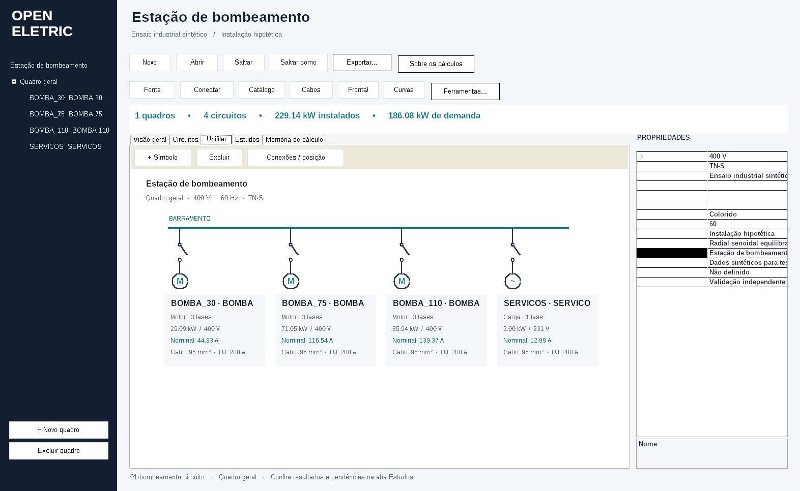
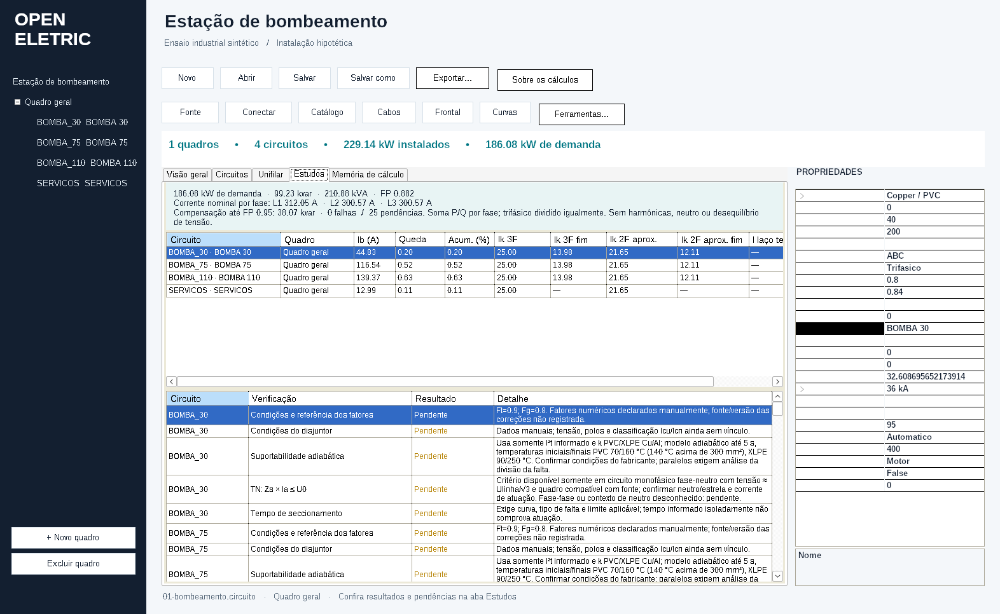
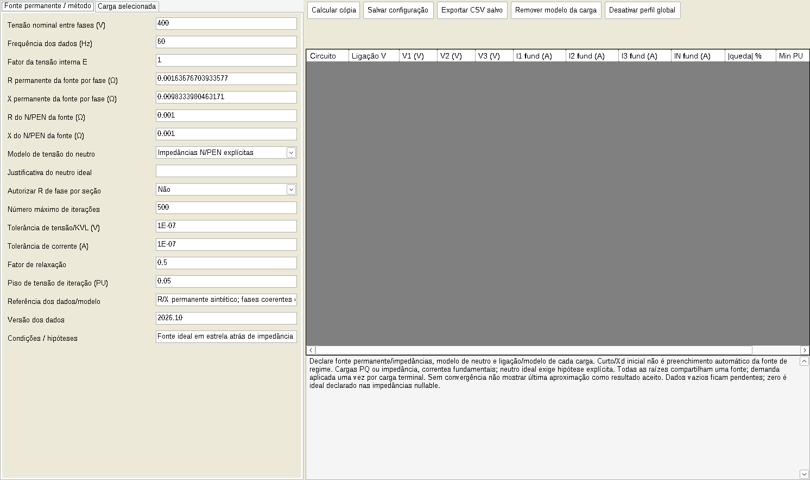

<p align="center"></p>

<p align="center">
<a href="https://github.com/poajefersonld-1983/OpenEletric/releases/latest"></a>
<a href="https://github.com/poajefersonld-1983/OpenEletric/actions/workflows/validacao.yml"></a>
<a href="LICENSE"></a>
</p>

**Organize quadros, conecte circuitos e acompanhe os resultados do seu projeto elétrico em uma interface visual.**

O OpenEletric reúne editor unifilar, dados de cargas e motores, estudos de cabos e proteções, fluxo por fase e relatórios. Você pode começar pelos **dez exemplos industriais** incluídos e acompanhar como cada entrada altera os resultados.

<p align="center"><a href="https://github.com/poajefersonld-1983/OpenEletric/releases/latest/download/OpenEletric-Windows-x64.zip"><strong>⬇ Baixar para Windows</strong></a> · <a href="https://github.com/poajefersonld-1983/OpenEletric/releases/latest/download/openeletric_0.2.0-1_amd64.deb"><strong>⬇ Baixar para Debian</strong></a> · <a href="docs/primeiros-passos.md"><strong>Guia com imagens</strong></a></p>

> Ferramenta de apoio a estudos. Resultados dependem dos dados e dos modelos declarados; não representam certificação normativa ou aprovação de fabricante. As limitações aparecem nos relatórios e em [escopo e validação](docs/validacao.md).

## Conheça a interface


**Um lugar para acompanhar o projeto:** quadros e circuitos à esquerda, área de trabalho ao centro e propriedades editáveis à direita.

|O que você quer fazer?|Onde começar|
|---|---|
|Criar uma instalação|**Novo** abre o assistente de projeto e alimentação.|
|Cadastrar ou editar cargas|Selecione um circuito e informe os dados em **Propriedades**.|
|Conectar quadros|Use **Conectar** para formar a rede radial.|
|Ver o desenho|Abra a aba **Unifilar**.|
|Conferir resultados e pendências|Abra **Estudos** ou **Ferramentas**.|
|Guardar o estudo|Clique em **Salvar**; o arquivo usa a extensão `.circuito`.|
|Compartilhar os resultados|Use relatórios e exportações PDF, HTML, CSV, SVG ou DXF, conforme o módulo.|

## Baixar e começar

### Windows 10/11 — 64 bits

1. [Baixe o pacote Windows](https://github.com/poajefersonld-1983/OpenEletric/releases/latest/download/OpenEletric-Windows-x64.zip).
2. Extraia o ZIP para uma pasta do seu usuário.
3. Abra **OpenEletric.exe**. O computador precisa do **.NET Framework 4.8**.

Se preferir o PowerShell, **cole o bloco inteiro abaixo**. Ele baixa a versão publicada, verifica o SHA256, extrai em uma pasta do usuário e abre o programa. Não precisa de administrador e não altera a política de execução do Windows.

```powershell
$ErrorActionPreference = 'Stop'
[Net.ServicePointManager]::SecurityProtocol = [Net.SecurityProtocolType]::Tls12
$base = 'https://github.com/poajefersonld-1983/OpenEletric/releases/latest/download'
$nome = 'OpenEletric-Windows-x64.zip'
$zip = Join-Path $env:TEMP $nome
$hashes = Join-Path $env:TEMP 'OpenEletric-SHA256SUMS.txt'
Invoke-WebRequest "$base/$nome" -OutFile $zip -UseBasicParsing
Invoke-WebRequest "$base/SHA256SUMS.txt" -OutFile $hashes -UseBasicParsing
$linha = @(Get-Content $hashes | Where-Object { $_ -match ('^[a-fA-F0-9]{64}\s+\*?' + [regex]::Escape($nome) + '$') })
if ($linha.Count -ne 1) { throw 'Verificacao do download indisponivel.' }
if ((Get-FileHash $zip -Algorithm SHA256).Hash -ne ($linha[0] -split '\s+')[0]) { throw 'Download incompleto ou diferente do publicado.' }
$pasta = Join-Path $env:LOCALAPPDATA ('OpenEletric\downloads\' + (Get-Date -Format 'yyyyMMdd-HHmmss'))
Expand-Archive $zip -DestinationPath $pasta -Force
Start-Process (Join-Path $pasta 'OpenEletric.exe')
```

Há também um [instalador PowerShell completo](scripts/Instalar-OpenEletric.ps1), para quem deseja atalho na área de trabalho e exemplos copiados sem substituir arquivos pessoais. Veja as [instruções detalhadas do Windows](docs/instalacao-windows.md).

### Debian 13 — amd64

A edição Debian é empacotada para o desktop Linux e usa **Wine64**, com o runtime **Wine Mono** incluído. Não é uma reescrita em GTK/Qt.

Baixe o `.deb` na [página de versões](https://github.com/poajefersonld-1983/OpenEletric/releases/latest) e, na pasta do arquivo, execute:

```bash
sudo apt install ./openeletric_0.2.0-1_amd64.deb
```

Depois abra **OpenEletric** no menu de aplicativos. A primeira abertura prepara o ambiente do usuário e copia os exemplos para a pasta de documentos. [Guia do Debian](docs/instalacao-debian.md).

## Desenho e análise lado a lado



Acompanhe a estrutura dos circuitos e suas informações nominais. Posições, etiquetas e símbolos são salvos com o projeto.



Os resultados distinguem **OK**, **Falha** e **Pendente**. Um dado desconhecido não é tratado como uma aprovação automática.



O módulo de fluxo usa ligações e impedâncias declaradas para calcular tensões, correntes por fase, neutro e perdas, dentro do seu escopo.

## Comece por um exemplo

A pasta [`examples/industriais`](examples/industriais) contém arquivos prontos para abrir:

|Exemplo|O que observar|
|---|---|
|Bombeamento|Motores de 30, 75 e 110 kW, rendimento e demanda.|
|Transportadores|Inversores com entrada elétrica separada da potência de eixo.|
|Forno industrial|**Teste negativo:** circuito propositalmente subdimensionado.|
|Oficina|Cargas desequilibradas e uma ligação fase-fase.|
|Compressores, antes/depois|Efeito de um banco de capacitores no fator de potência nominal.|
|Gerador de 690 V|Carga nominal e curto inicial subtransitório.|
|UPS inversor/bypass|Modelos separados, sem presumir transferência automática.|
|Indústria em três níveis|Rede MT/BT com quadros de produção e utilidades.|

São cenários **sintéticos para aprendizado e verificação**, não projetos executivos. No exemplo dos compressores, a compensação leva o FP nominal de **0,8414 para 0,9500**, preservando a potência ativa de **171,251 kW**.

## Recursos e limites

- Projetos com dados de instalação, quadros, circuitos, backup e recuperação.
- Desenho unifilar com edição de posição, conexões, etiquetas e símbolos.
- Cargas, motores, inversores, compensação, fontes de rede, gerador e UPS.
- Cabos, queda de tensão, neutro/PE/PEN, proteções e dados de catálogo rastreáveis.
- Fluxo radial por fase e estudos de curto nos modelos declarados.
- Relatórios e intercâmbio de dados/desenhos.

**AMB é inspeção com prévia limitada e reexportação integral.** Não é um editor AMB geral, conversor AMB↔DXF ou importador dos cálculos do ABB. O suporte DXF também é delimitado. Veja [intercâmbio de desenhos](analise/INTERCAMBIO-DXF-AMB.md).

A matriz original tem 40 itens verificados **no escopo documentado**, sem afirmar equivalência integral a outros programas. A base de desenvolvimento passou por testes automatizados e conferências independentes. O [workflow Windows](https://github.com/poajefersonld-1983/OpenEletric/actions/workflows/validacao.yml) informa a validação nativa desta publicação. [Detalhes de testes e fórmulas](docs/validacao.md).

## Documentação

- [Primeiros passos, com imagens](docs/primeiros-passos.md)
- [Instalação no Windows e PowerShell](docs/instalacao-windows.md)
- [Instalação e remoção no Debian](docs/instalacao-debian.md)
- [Escopo, modelos e validação](docs/validacao.md)
- [Compilar e contribuir](docs/desenvolvimento.md)
- [Matriz de funções](analise/MATRIZ-FUNCOES.csv)

Encontrou um problema? [Abra uma issue](https://github.com/poajefersonld-1983/OpenEletric/issues/new) com a versão, o sistema e os passos para reproduzir. Use um exemplo sintético quando possível e remova dados de clientes antes de compartilhar um projeto.

## Licença

Código próprio sob a [licença MIT](LICENSE). Bibliotecas e runtimes mantêm suas licenças originais, listadas em [créditos e dependências](THIRD_PARTY_NOTICES.md). O OpenEletric é um projeto independente, sem vínculo ou homologação dos fabricantes citados em referências de catálogo.
