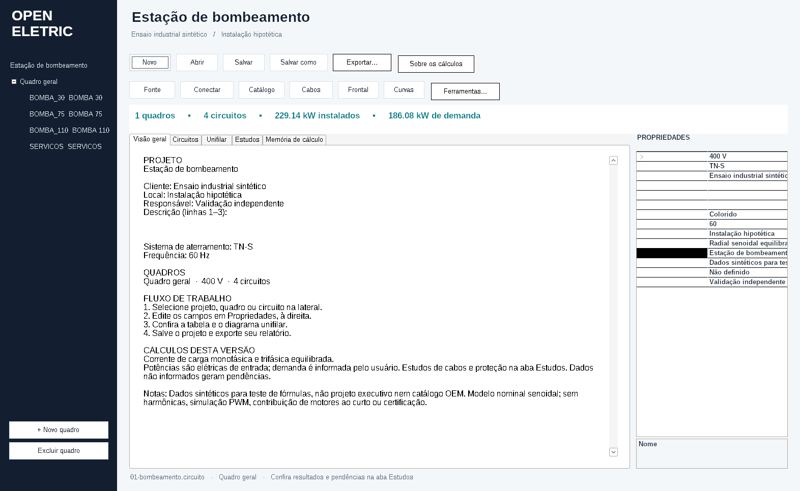

# Instalar e abrir no Windows

## Requisitos

- Windows 10 ou 11, 64 bits.
- .NET Framework 4.8. Se estiver ausente, use o [download oficial da Microsoft](https://dotnet.microsoft.com/download/dotnet-framework/net48).
- Uma pasta do seu usuário para guardar os projetos.

## Opção 1 — baixar o ZIP

1. Abra [a última versão](https://github.com/poajefersonld-1983/OpenEletric/releases/latest).
2. Baixe `OpenEletric-Windows-x64.zip`.
3. Extraia o ZIP inteiro e abra `OpenEletric.exe`.
4. Os arquivos de exemplo ficam em `exemplos`. Use **Salvar como** para guardar sua cópia em **Documentos/OpenEletric**.

## Opção 2 — PowerShell

O [bloco pronto da página principal](../README.md#windows-1011--64-bits) baixa, verifica o SHA256, extrai e abre o executável. Basta copiar o bloco inteiro para o PowerShell. Não precisa abrir como administrador.

O script [`Instalar-OpenEletric.ps1`](../scripts/Instalar-OpenEletric.ps1) oferece uma instalação mais organizada: cria um atalho na área de trabalho e copia os exemplos para Documentos/OpenEletric/Exemplos sem substituir cópias já existentes. Ele instala o programa por versão em `%LOCALAPPDATA%/OpenEletric/versions`.

Se você baixou o script separado, leia seu conteúdo antes de executá-lo e siga a política de scripts da sua organização. O método do bloco na página principal não exige executar um arquivo `.ps1` nem alterar essa política.

## Se não abrir

- Confira se o ZIP foi extraído por inteiro e se o .NET Framework 4.8 está instalado.
- Baixe os arquivos apenas da página de versões deste repositório. O release inclui `SHA256SUMS.txt` para conferir a integridade.
- O executável não recebe assinatura comercial de código nesta edição. Não desative o antivírus ou as proteções do Windows para abri-lo; confira a origem e as orientações da sua organização.
- Ao pedir ajuda, informe a versão e a mensagem exibida, sem compartilhar dados de clientes.

## Atualização e remoção

Faça uma cópia de segurança dos projetos antes de atualizar. Instale a nova versão em outra pasta ou use o instalador por versão. Os arquivos de Documentos/OpenEletric devem ser mantidos separados do programa.

Para remover uma cópia portátil, feche o aplicativo e remova a pasta extraída e o atalho correspondente. Não remova seus projetos junto com o programa.
