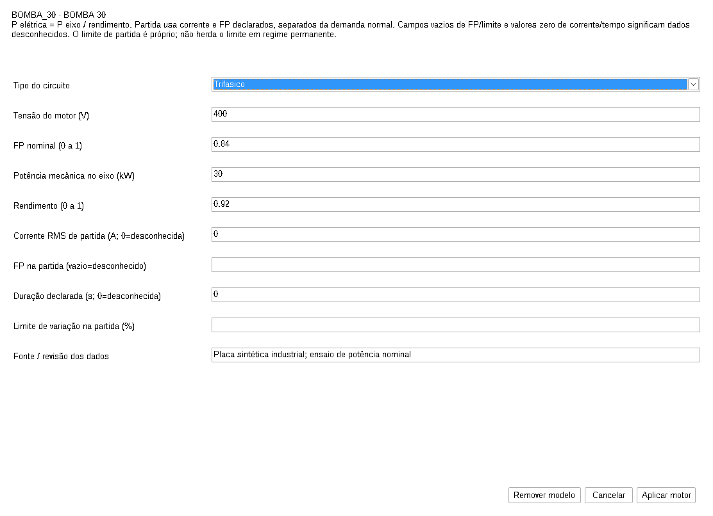
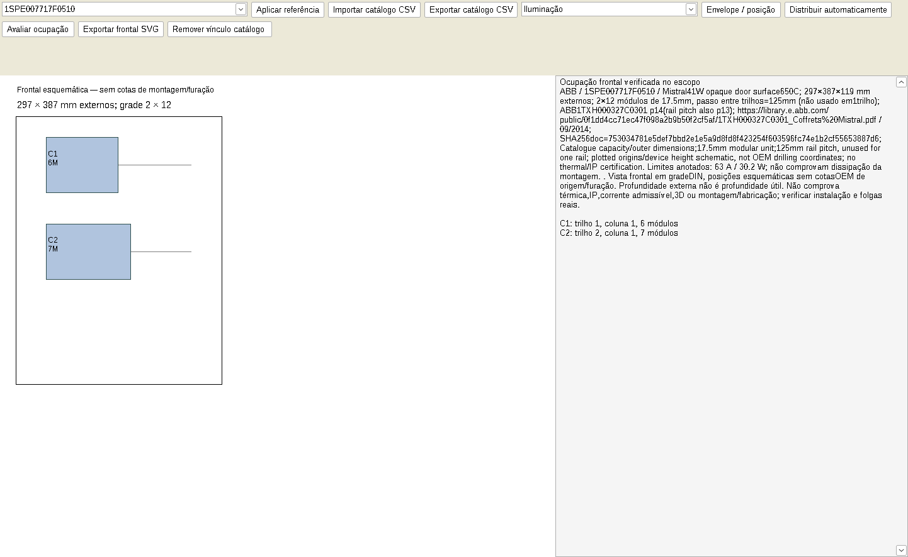
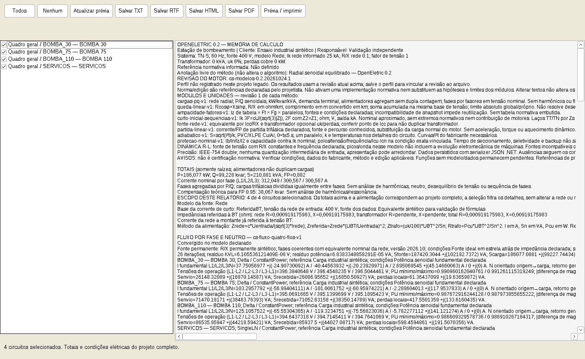

# Seu primeiro projeto no OpenEletric

Você não precisa começar do zero. Depois de [baixar o programa](../README.md#baixar-e-começar), abra um dos arquivos de [`examples/industriais`](../examples/industriais).

## 1. Abra um exemplo e conheça a tela

Clique em **Abrir** e escolha `01-bombeamento.circuito`. A esquerda mostra o quadro geral e seus circuitos. A área central acompanha o que foi selecionado.

Para criar um arquivo próprio, use **Novo**. O assistente pede os dados do projeto, o modelo de alimentação e a configuração inicial. Ao final, revise os dados antes de concluir.

## 2. Selecione a carga e informe seus dados

Selecione um circuito na lateral. Use as propriedades para nome, potência, tensão, fator de potência e demanda. Para um motor, prefira o módulo **Motor**, que separa potência mecânica, rendimento e dados de partida.

Campos desconhecidos devem permanecer sem informação quando o módulo permitir. O programa apresenta pendências em vez de presumir dados de fabricante.

## 3. Veja o unifilar

Abra a aba **Unifilar** para conferir o quadro. As etiquetas mostram identificação e valores nominais. As funções de conexão e posição ajudam a organizar a rede e o desenho.

## 4. Confira resultados e pendências

A aba **Estudos** apresenta as verificações. **Falha** significa que uma comparação do modelo não foi atendida; **Pendente** significa que faltam dados ou que o modelo não cobre aquela conclusão.

Em uma rede com ligações e impedâncias de regime permanente declaradas, use **Fluxo por fase** para consultar tensões, correntes e perdas.

## 5. Organize a frente do quadro

O módulo de invólucros permite conferir os modelos cadastrados, os dispositivos e a ocupação da frente do quadro dentro do alcance declarado.

Isso não substitui ensaio térmico, validação IP, projeto mecânico ou fabricação.

## 6. Salve e compartilhe

Use **Salvar como** para criar sua cópia `.circuito`. Depois use os relatórios para selecionar o conteúdo e gerar a saída desejada.

Guarde também os dados de entrada e as referências de catálogo. Os exemplos do repositório são sintéticos e servem para explorar a ferramenta; não são instalações prontas para execução.

[Voltar à apresentação](../README.md) · [Entender os modelos e limites](validacao.md)
